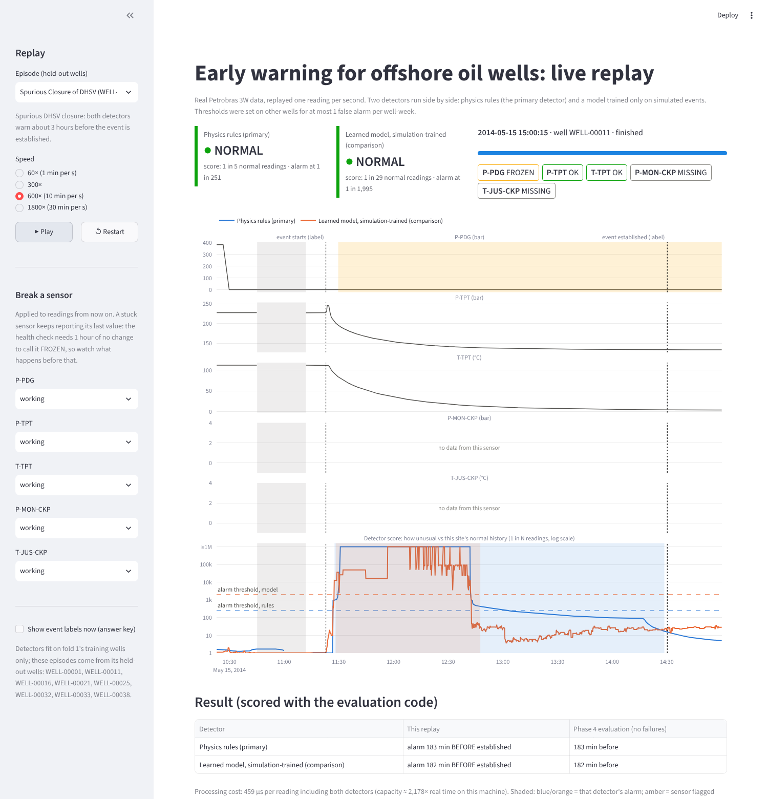

# Oil Well Early-Warning System (Petrobras 3W 2.0.0)

Warns a production operator **before** an undesirable event in an offshore oil well
becomes established. It is scored on lead time and false alarms per well-day, never
accuracy, and tested on the question an operator actually asks: *can simulated events
plus my own wells' normal history replace labeled real events?*

> Status: Phases 0-5 complete: data audit, causal feature pipeline, four baselines ([results](reports/phase2_baselines.md)), the main model ([results](reports/phase3_model.md)), the sensor-degradation study ([results](reports/phase4_degradation.md)) and a live streaming replay demo ([below](#streaming-replay-demo-phase-5)). **Headline: under sim-to-real shift, hand-written physics rules beat a learned gradient-boosted model, and stay ahead as sensors fail.** Phase 6 (design doc) next.

## What is here

| Path | Purpose |
|---|---|
| `src/ew3w/schema.py` | 3W constants, sensor groups, physical plausibility ranges, unit fixes |
| `src/ew3w/data.py` | Instance discovery/loading, per-well timeline stitching with overlap de-duplication |
| `src/ew3w/quality.py` | Causal sensor health: OK / MISSING / FROZEN / INVALID |
| `src/ew3w/features.py` | Causal 10 s window features for the 5 shared sensors (Phase 1) |
| `src/ew3w/alerting.py` | Hysteresis alerter (one `step()` for offline eval and streaming) |
| `src/ew3w/metrics.py` | Event-level metrics: delay, lead time, censoring, false alarms per well-day (exact Poisson CI), well-cluster bootstrap |
| `src/ew3w/splits.py` | Well-grouped folds and protocols P1-P4 (sim-only to real+sim) |
| `src/ew3w/evaluation.py` | One harness for every scorer: training rows per protocol, out-of-fold calibration, FA-budget thresholds, test scoring |
| `src/ew3w/baselines.py` | Health-only, physics rules, rolling z-score, isolation forest (Phase 2) |
| `src/ew3w/model.py` | Main model: gradient-boosted trees with missingness-matched sensor dropout, plus variants (Phase 3) |
| `src/ew3w/degradation.py` | Sensor-failure injection: missing (exact feature transform) and frozen (raw injection + rebuild) (Phase 4) |
| `src/ew3w/stream.py` | The streaming service: one reading in, scored row out; exact compact thresholds; DEGRADED-when-blind display rule (Phase 5) |
| `scripts/audit_dataset.py` | Reproduces every number in the plan; writes `reports/data_audit.md` |
| `scripts/build_features.py` | Builds the feature cache under `data/features/<config key>/` |
| `scripts/run_baselines.py` | Runs every baseline x protocol; writes `reports/phase2_baselines.md` |
| `scripts/run_model.py` | Runs the main model, its variants and the paired test; writes `reports/phase3_model.md` |
| `scripts/run_degradation.py` | Phase 4 study; writes `reports/phase4_degradation.md` and the chart; `--resume`, `--replot` |
| `scripts/export_demo.py` | Freezes the demo detectors (`models/`), cuts replay clips (`demo_data/`), re-checks every clip against Phase 4 |
| `scripts/bench_stream.py` | Cost per reading of the streaming service |
| `app/demo.py` | Streamlit live replay: two detectors, status lamps, break-a-sensor controls (Phase 5) |
| `tests/test_core.py` | Unit tests: data, health, alerter, metrics, folds |
| `tests/test_features.py` | Phase 1 gate: causality, streaming == batch, bad-sensor robustness |
| `tests/test_evaluation.py` | Phase 2 harness: no test-well data in training or calibration, exact scoring of a known event |
| `tests/test_model.py` | Phase 3: sensor dropout removes the which-sensors-are-present shortcut; paired-test arithmetic |
| `tests/test_degradation.py` | Phase 4: injected failures match a rebuild from raw data exactly |
| `tests/test_stream.py` | Phase 5 gate: streaming == batch features and alerts; compact thresholds give identical decisions |
| `tests/test_app.py` | Phase 5: the app replays headless; silent blindness shows DEGRADED; a stuck sensor is flagged after 1 h |
| `tests/test_real_data.py` | Integration tests on the real dataset (set `EW3W_DATASET`) |

## Setup (Windows, PowerShell)

```powershell
git clone --depth 1 https://github.com/petrobras/3W.git C:\data\3W   # ~1.9 GB dataset
cd oilwell-early-warning
python -m venv .venv
.\.venv\Scripts\Activate.ps1
pip install -e ".[dev,demo]"
$env:EW3W_DATASET = "C:\data\3W"   # where YOUR 3W clone is: repo root or its dataset folder
python -m pytest -q                # 92 tests (7 read the real dataset, 3 drive the app)
python scripts/audit_dataset.py    # ~5-10 min on a laptop
python scripts/build_features.py   # ~10-20 min on a laptop, ~400 MB of disk
python scripts/run_baselines.py    # ~1-2 h on a laptop, ~4.2 GB peak RAM
python scripts/run_model.py        # ~1-2 h on a laptop, ~4.1 GB peak RAM
python scripts/run_degradation.py  # ~1.5-2.5 h on a laptop, ~3.2 GB peak RAM; --resume after an interruption
python scripts/export_demo.py      # ~2-5 min, ~3.7 GB peak RAM (optional: models/ and demo_data/ are committed)
streamlit run app/demo.py          # the live replay; needs neither the dataset nor the feature cache
```

## Features (Phase 1)

One row every 10 s (epoch-aligned, emitted only when the block is complete), 79 features from the
5 sensors every source shares (P-PDG, P-TPT, T-TPT, P-MON-CKP, T-JUS-CKP) plus two pressure
differences (P-PDG − P-TPT, P-TPT − P-MON-CKP):

- **Per signal, windows 1 / 5 / 30 min:** level vs a lagged 6 h robust baseline, change vs the previous window, variability. All in robust-scale units, never absolute values (absolute pressure identifies the well).
- **Scale floors** (0.5 bar, 0.5 °C): simulated steady states are noise-free, so without a floor a change would score ~80× higher in simulation than in a real well.
- **Per sensor:** health code, fraction usable in the last 5 min, staleness (seconds since last change, for historian-held sensors), plus the count of usable sensors.

Guarantees, enforced by `tests/test_features.py`: no feature uses data after its timestamp (prefix
invariance and future-perturbation tests), a live service keeping only `FeatureConfig.history_s`
(7.5 h) of data reproduces batch features, and state resets at data gaps.

## Baselines (Phase 2)

Every scorer runs through one harness. Thresholds are set on **training wells only**: the lowest
threshold with at most 1 false alarm per well-week **and** at most 1% time in alarm on training
normal data, using **out-of-fold** scores for anything that learns. Then the held-out wells are
scored. Full tables, per-class results and operating curves: [`reports/phase2_baselines.md`](reports/phase2_baselines.md).

| Baseline (P2: simulated events + site normal history) | Warned before established [95% CI] | Recall | FA / well-day [95% CI] | Time in alarm |
|---|---|---|---|---|
| physics rules | 0.58 [0.41, 0.76] | 0.22 | 0.164 [0.099, 0.256] | 0.8% |
| rolling z-score | 0.48 [0.26, 0.69] | 0.09 | 0.129 [0.072, 0.213] | 0.4% |
| isolation forest | 0.31 [0.14, 0.50] | 0.07 | 0.138 [0.079, 0.224] | 0.5% |
| health only | 0.12 [0.00, 0.32] | 0.21 | 0.147 [0.085, 0.235] | 1.3% |

- **Simulation-only calibration (P1) fails on real wells:** physics rules raise 1.88 and z-score 2.85 false alarms per well-day (13-20x the budget), in alarm 33-46% of the time. Isolation forest meets the false-alarm count but is in alarm 25% of the time.
- **The sensor-health shortcut does not transfer:** calibrated honestly (out of fold), health-only detects nothing under P3/P4.
- **The number to beat in Phase 3:** physics rules under P2, warned before establishment for 58% of events at 0.16 false alarms per well-day. Flow instability (class 4, 343 events, unseen in simulation) is almost never detected by any baseline.

## Main model (Phase 3)

Gradient-boosted trees on the 63 value features. **Missingness-matched sensor dropout:** each
simulated training row gets the sensor-availability pattern of a real row, so "which sensors are
present" carries no label information. Same harness and budgets as Phase 2. Full report:
[`reports/phase3_model.md`](reports/phase3_model.md).

| P2 (simulated events + site normal history) | Warned before established [95% CI] | FA / well-day | Time in alarm |
|---|---|---|---|
| physics rules (best baseline) | **0.58** [0.41, 0.76] | 0.164 | 0.8% |
| gbdt trained on simulation only | 0.42 [0.24, 0.61] | 0.216 | 0.3% |
| gbdt (main model) | 0.29 [0.16, 0.44] | 0.009 | 0.0% |
| gbdt without dropout | 0.10 [0.00, 0.25] | 0.129 | 0.8% |

Paired on the same 48 events: gbdt − physics rules = **−0.29 [−0.50, −0.09]**, a clear loss.
Why the learned model loses, from measurements:

- **The P2 training set confounds source with label.** Positives are simulated, negatives are real, so the model can learn "looks simulated" instead of "is an event". Training on simulation only (simulated normal vs simulated events) and using site data only for the threshold removes that confound and lifts warned from 0.29 to 0.42; the gap to physics rules shrinks to −0.17 [−0.35, +0.02].
- **Simulated values differ from real ones, not just availability.** A classifier tells simulated from real normal rows at ROC-AUC 0.990; after giving simulated rows real availability patterns it still reaches 0.823. A learned model fits those simulation-specific signatures.
- **Physics rules encode directions of change** (pressure up here, temperature down there), which survive the shift.
- **Dropout is necessary:** +0.19 [+0.05, +0.33] warned versus the same model without it.

Two independent full runs produced byte-identical reports and outcome files.

## Sensor degradation (Phase 4)

Physics rules (the primary detector) and the simulation-only model, each trained and thresholded
once per fold on clean training wells, then frozen. Failures are injected into the held-out wells
only: every subset of 1-4 missing sensors (30 subsets), and each sensor frozen before event onset.
Full report: [`reports/phase4_degradation.md`](reports/phase4_degradation.md).


| Sensors missing | Physics rules: warned | Sim-trained model: warned | Physics rules: silent blindness |
|---|---|---|---|
| 0 | 0.58 | 0.42 | 0.7% |
| 1 | 0.48 | 0.25 | 1.9% |
| 2 | 0.36 | 0.13 | 11.4% |
| 3 | 0.19 | 0.05 | 30.8% |
| 4 | 0.00 | 0.00 | 0.0% (system DEGRADED) |

- **Physics rules stay ahead at every level of sensor loss**, and lose ground more slowly.
- **Failures fail quiet, not loud:** false alarms fall as sensors go missing (physics rules 0.164 to 0.030 per well-day at 3 missing), so a broken sensor never floods the operator.
- **The danger is silent blindness:** with 2-3 sensors missing, the rules cannot evaluate 11-31% of the time while the status still reads normal. The DEGRADED rule (fewer than 2 usable sensors) is detector-blind; the status must also go DEGRADED whenever the detector has no score. This changes the display only, never the alerts.
- **Real instrumentation is thin:** with one more sensor missing, 19% of events begin while the system is already DEGRADED.
- **Dropout moves the learned model's reliance instead of removing it.** Averaged over failures it makes no difference (0.25 vs 0.26 warned with one sensor missing). Per sensor: with dropout the model survives losing P-PDG (0.42 vs 0.08), the sensor real wells lose most often, but it collapses without T-TPT (0.04 vs 0.25) or P-TPT (0.10 vs 0.31).
- **Frozen sensors:** a frozen choke pressure (P-MON-CKP) costs the rules the most (warned -0.19); a frozen T-TPT costs the model the most (-0.29).

## Streaming replay demo (Phase 5)

```powershell
pip install -e ".[demo]"
streamlit run app/demo.py
```

Replays real wells second by second through the same code the evaluation used. Physics rules
are the primary detector; the simulation-trained model runs alongside for comparison. Both were
fit and thresholded on fold 1's training wells; every episode comes from that fold's **held-out**
wells. Event labels stay hidden until the replay passes them. The sidebar can kill or freeze any
sensor mid-replay.



**The demo is the evaluated system, and that is tested, not asserted:**

- `src/ew3w/stream.py` computes the Phase 1 features incrementally from bounded state (a ~6.5 h
  ring of 10 s block means, plus per-sensor counters). Against the batch pipeline it produces the
  same rows, identical health codes, staleness and NaN patterns, and values equal to the last stored
  digit. On real WELL-00011, 6 of 1.26 M values differ by one unit in the third decimal, because
  pandas' rolling mean adds and drops values in a different order (`tests/test_stream.py`,
  `tests/test_real_data.py`).
- Alerts come from the same hysteresis `step()` the evaluation ran; the test replays a well through
  the engine and gets status codes identical to the batch evaluation path.
- Thresholds ship as a compact tail of the training-normal score distribution (2.9 MB for both
  detectors). Every alarm and clear decision is identical to the full calibration; below the tail,
  percentiles are approximate and used for display only.
- `scripts/export_demo.py` streams every clip and scores it with the Phase 4 metric code:
  **12 of 12 detector-event outcomes match Phase 4 to the minute** (for example, DHSV closure:
  rules warn 183 min and the model 182 min before establishment).

**Episodes:** DHSV closure (both warn, ~3 h ahead), BSW increase (only rules warn, 159 min),
productivity loss twice (both warn 44 min; only the model warns 53 min), slow choke scaling (rules,
255 min), service-line hydrate (both miss: it acts on gas-lift sensors outside the shared set), six
quiet hours of normal operation, and one real physics-rules false alarm, shown on purpose.

**The Phase 4 fix, live:** a lamp reads DEGRADED, with the reason, whenever its detector has no
score, even when 2 or more sensors still work (the evaluated rule). Kill P-TPT, T-TPT and
P-MON-CKP before the productivity-loss event: the old rule says "not degraded"; the rules lamp now
says DEGRADED ("this detector's sensors are unavailable"); the model keeps scoring. Alerts are
never changed by this rule, only the label on a quiet NORMAL.

**Cost** (`scripts/bench_stream.py`, one laptop core, 11.7 h real clip):

| Configuration | µs per reading | Headroom over real time, one well |
|---|---|---|
| Features only | 155 | 6,461× |
| + physics rules | 221 | 4,532× |
| + both detectors, scored per 10 s row (live) | 603 | 1,658× |
| + both detectors, scoring batched (warm-up) | 159 | 6,283× |

**Known issues found by the demo (for the design doc):**

- *Alarms right after a data gap.* For the first hour of a new segment no 6 h baseline exists, so
  the oscillation rule's scale falls back to its 0.5 bar floor and ordinary choke-pressure noise
  scores high. That is the demo's false alarm: raised 16 min after data resumes.
- *The dead-band can hold an alarm for hours.* The clearing threshold sits one decade below the
  alarm threshold (1 in 25 vs 1 in 251 for the rules). The same false alarm stays active for 164 min,
  until the clip ends, while its score sits between the two. The evaluation counts it as one
  episode, but an operator lives with it for hours.
- The saved detectors are pickles: load them with the scikit-learn version that wrote them
  (`app/requirements.txt` pins it; the app warns on a mismatch). Re-running `export_demo.py`
  re-freezes them for your environment.

## Key audit findings (from `reports/data_audit.md`)

- Simulated/drawn instances carry only 5 sensors; P-PDG is healthy in 18% of real normal samples but 100% of synthetic ones.
- A random forest that sees **only which sensors are broken** reaches ROC-AUC 0.986 under a random split and 0.740 grouped by well. All splits are grouped by well, and 0.740 is a baseline to beat.
- Real instances overlap their predecessor by exactly the 1-hour unlabeled lead-in: 116.0 de-duplicated normal well-days vs 140.7 naive.
- Many healthy P-TPT/T-TPT series are held for ~601 s between historian updates, so the frozen rule uses 1 hour (and runs on real data only).
- Historian fill values (P-PDG = 1.18e42 Pa, -999 °C) are flagged INVALID.
- **All 20 hand-drawn instances store pressure in bar**, although `dataset.ini` declares Pa; they are converted at load time.
- 43 of 57 real class-9 instances contain no event label and are excluded from scoring.
- Even after normalisation, real normal operation is far "busier" than simulated normal: median |P-TPT 5-min level| is 0.336 vs 0.014 robust-scale units. A threshold tuned on simulation alone will over-alarm on real wells; Phase 3's P1 vs P2 comparison measures exactly this.

## Data licence

3W Dataset by Petrobras, CC BY 4.0: https://github.com/petrobras/3W
