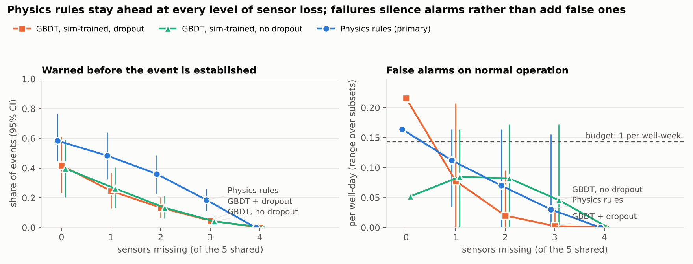

# Phase 4: sensor-degradation study

Detectors trained and thresholded once per fold on CLEAN training wells (P2: simulated events + site normal history; <= 1 false alarm per well-week and <= 1% time in alarm), then frozen. Failures are injected into the held-out wells only. Warned/recall CIs: well-cluster bootstrap over events, each event averaged over every sensor subset of that size first. False alarms: mean and range over subsets. Bootstrap: 2000 resamples.

## By number of missing sensors

| Detector | Missing | Subsets | Warned [95% CI] | Recall [95% CI] | FA / well-day mean [min, max] | Silent blindness | Onsets while DEGRADED |
|---|---|---|---|---|---|---|---|
| GBDT, sim-trained, dropout | 0 | 1 | 0.42 [0.23, 0.61] | 0.23 [0.10, 0.49] | 0.216 [0.216, 0.216] | 0.0% | 3% |
| GBDT, sim-trained, dropout | 1 | 5 | 0.25 [0.13, 0.37] | 0.12 [0.05, 0.25] | 0.078 [0.000, 0.207] | 0.0% | 19% |
| GBDT, sim-trained, dropout | 2 | 10 | 0.13 [0.07, 0.20] | 0.05 [0.02, 0.10] | 0.020 [0.000, 0.095] | 0.0% | 34% |
| GBDT, sim-trained, dropout | 3 | 10 | 0.05 [0.02, 0.07] | 0.01 [0.00, 0.03] | 0.003 [0.000, 0.026] | 0.0% | 57% |
| GBDT, sim-trained, dropout | 4 | 5 | 0.00 [0.00, 0.00] | 0.00 [0.00, 0.00] | 0.000 [0.000, 0.000] | 0.0% | 100% |
| GBDT, sim-trained, no dropout | 0 | 1 | 0.40 [0.20, 0.59] | 0.23 [0.07, 0.54] | 0.052 [0.052, 0.052] | 0.0% | 3% |
| GBDT, sim-trained, no dropout | 1 | 5 | 0.26 [0.13, 0.40] | 0.15 [0.04, 0.34] | 0.085 [0.000, 0.164] | 0.0% | 19% |
| GBDT, sim-trained, no dropout | 2 | 10 | 0.13 [0.06, 0.21] | 0.07 [0.02, 0.16] | 0.082 [0.000, 0.172] | 0.0% | 34% |
| GBDT, sim-trained, no dropout | 3 | 10 | 0.04 [0.01, 0.08] | 0.01 [0.00, 0.03] | 0.046 [0.000, 0.172] | 0.0% | 57% |
| GBDT, sim-trained, no dropout | 4 | 5 | 0.00 [0.00, 0.00] | 0.00 [0.00, 0.00] | 0.000 [0.000, 0.000] | 0.0% | 100% |
| Physics rules (primary) | 0 | 1 | 0.58 [0.41, 0.77] | 0.22 [0.11, 0.41] | 0.164 [0.164, 0.164] | 0.7% | 3% |
| Physics rules (primary) | 1 | 5 | 0.48 [0.33, 0.64] | 0.17 [0.08, 0.32] | 0.112 [0.034, 0.164] | 1.9% | 19% |
| Physics rules (primary) | 2 | 10 | 0.36 [0.23, 0.49] | 0.12 [0.06, 0.23] | 0.070 [0.000, 0.164] | 11.4% | 34% |
| Physics rules (primary) | 3 | 10 | 0.19 [0.11, 0.26] | 0.06 [0.03, 0.13] | 0.030 [0.000, 0.155] | 30.8% | 57% |
| Physics rules (primary) | 4 | 5 | 0.00 [0.00, 0.00] | 0.00 [0.00, 0.00] | 0.000 [0.000, 0.000] | 0.0% | 100% |

**Silent blindness** = share of rows where the detector produces no score (its inputs are unavailable) while the system is NOT in DEGRADED, so the screen shows an all-clear the detector cannot back up. **Onsets while DEGRADED** = events that begin while fewer than 2 sensors are usable.

**Design consequence:** the DEGRADED rule (fewer than 2 usable sensors) is detector-blind. Physics rules need specific sensor combinations, so with 2-3 sensors missing they often cannot evaluate at all while the status still reads normal. The status must also go DEGRADED whenever the detector has no score. That changes only what the operator is shown, not when alerts fire (a missing score already blocks new alerts and never clears an active one), so every number in this report is unaffected.

## Single sensor missing

| Sensor | Physics rules (primary) | GBDT, sim-trained, dropout | GBDT, sim-trained, no dropout |
|---|---|---|---|
| P-PDG | warned 0.58, FA 0.164, silent 1% | warned 0.42, FA 0.207, silent 0% | warned 0.08, FA 0.000, silent 0% |
| P-TPT | warned 0.42, FA 0.034, silent 2% | warned 0.10, FA 0.000, silent 0% | warned 0.31, FA 0.164, silent 0% |
| T-TPT | warned 0.50, FA 0.164, silent 1% | warned 0.04, FA 0.017, silent 0% | warned 0.25, FA 0.060, silent 0% |
| P-MON-CKP | warned 0.35, FA 0.043, silent 5% | warned 0.35, FA 0.095, silent 0% | warned 0.33, FA 0.155, silent 0% |
| T-JUS-CKP | warned 0.56, FA 0.155, silent 1% | warned 0.31, FA 0.069, silent 0% | warned 0.33, FA 0.043, silent 0% |

## Single sensor frozen before onset (raw injection, features rebuilt)

| Sensor | Physics rules (primary) | GBDT, sim-trained, dropout | GBDT, sim-trained, no dropout |
|---|---|---|---|
| P-PDG | warned 0.58 (+0.00), FA 0.164 (+0.000) | warned 0.42 (+0.00), FA 0.207 (-0.009) | warned 0.25 (-0.15), FA 0.017 (-0.034) |
| P-TPT | warned 0.50 (-0.08), FA 0.198 (+0.034) | warned 0.25 (-0.17), FA 0.172 (-0.043) | warned 0.35 (-0.04), FA 0.052 (+0.000) |
| T-TPT | warned 0.56 (-0.02), FA 0.164 (+0.000) | warned 0.12 (-0.29), FA 0.121 (-0.095) | warned 0.25 (-0.15), FA 0.060 (+0.009) |
| P-MON-CKP | warned 0.40 (-0.19), FA 0.155 (-0.009) | warned 0.35 (-0.06), FA 0.147 (-0.069) | warned 0.35 (-0.04), FA 0.060 (+0.009) |
| T-JUS-CKP | warned 0.56 (-0.02), FA 0.164 (+0.000) | warned 0.35 (-0.06), FA 0.172 (-0.043) | warned 0.38 (-0.02), FA 0.052 (+0.000) |

Differences in brackets are against the clean condition.

## Clean reference

| detector                    |   warned |   n_warned |   recall |   fa_per_well_day |   fa_lo |   fa_hi |   time_in_alarm |   silent_blind_pct |
|:----------------------------|---------:|-----------:|---------:|------------------:|--------:|--------:|----------------:|-------------------:|
| physics_rules               |    0.583 |         48 |    0.218 |             0.164 |   0.099 |   0.256 |           0.008 |              0.735 |
| gbdt_sim_trained            |    0.417 |         48 |    0.234 |             0.216 |   0.14  |   0.318 |           0.003 |              0     |
| gbdt_sim_trained_no_dropout |    0.396 |         48 |    0.226 |             0.052 |   0.019 |   0.113 |           0.01  |              0     |
